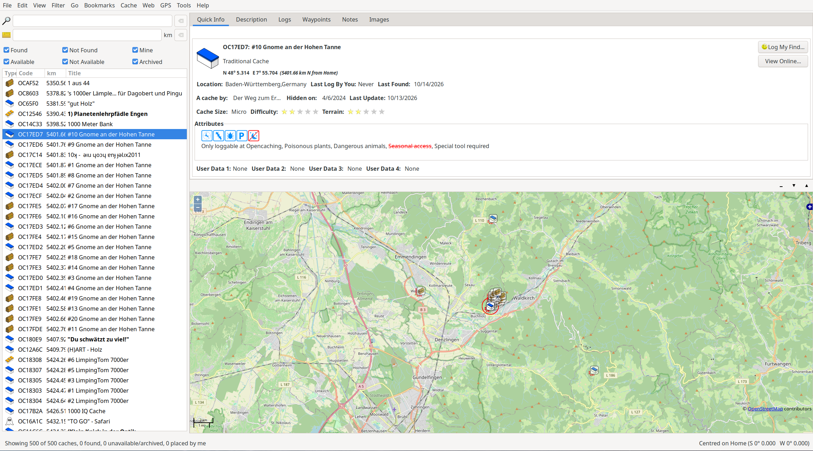

Dies ist ein Fork der eingestellen Geocaching Software "OpenCacheManager" 
(http://opencachemanage.sourceforge.net/).  
User Ziel ist die Weiterentwickligung der Software. Hierfuer benoetigen wir 
jedoch Eure Unterstuetzung. Bitte testet die Software, benutzt sie, oeffnet 
Feature-Requests und spendet auch etwas. Denn wie auch der Entwickler vor 
uns, so haben auch wir Familie! Wenn genug Geld zusammen kommt, kann für bestimmte
Tätigkeiten einen externer Entwickler beauftragen. :-)

### Linux-Build mit CMake (.NET 8)

Der GTK-Client kann unter Linux mit CMake und dem .NET 8 SDK gebaut werden.
Das Standardziel veröffentlicht die Anwendung selbstenthaltend für `linux-x64`
und kopiert die benötigten Programmressourcen in das Build-Verzeichnis:

```sh
cmake -S . -B build-nix/csharp-cmake
cmake --build build-nix/csharp-cmake --parallel 1
```

Der veröffentlichte Client liegt anschließend in
`build-nix/csharp-cmake/out/app/`.

#### AppImage erzeugen

Das optionale CMake-Ziel `appimage` erzeugt ein x86_64-AppImage mit dem
`quick-sharun`-Werkzeug aus
[Anylinux-AppImages](https://github.com/pkgforge-dev/Anylinux-AppImages).
Das Werkzeug wird beim ersten Aufruf aus einem festgelegten Upstream-Commit
geladen und per SHA256 geprüft. Neben CMake und .NET 8 benötigt der Build die
GTK3-/WebKitGTK-4.1-Laufzeitbibliotheken, `glib-networking`, `patchelf` und
`Xvfb`; die Laufzeitbibliotheken müssen in der Build-Umgebung auffindbar sein.
Bei nicht standardmäßigen Installationspfaden kann die Umgebung beispielsweise
so gesetzt werden:

```sh
export LD_LIBRARY_PATH="/pfad/zu/gtk3/lib:/pfad/zu/webkitgtk/lib:/pfad/zu/glib-networking/lib${LD_LIBRARY_PATH:+:$LD_LIBRARY_PATH}"
export GIO_EXTRA_MODULES="/pfad/zu/glib-networking/lib/gio/modules"
```

AppImage bauen und den erzeugten Pfad ausgeben lassen:

```sh
cmake --build build-nix/csharp-cmake --target appimage --parallel 1
```

Das Ergebnis wird unter `build-nix/csharp-cmake/appimage/` abgelegt. Der
Dateiname enthält die in `ocm-gtk/version/Version.txt` angegebene Version.
Der zusätzliche Smoke-Test lässt sich mit folgendem Ziel starten:

```sh
cmake --build build-nix/csharp-cmake --target appimage-test --parallel 1
```

**Statushinweis:** Das AppImage bündelt den von sharun benötigten ELF-Interpreter
unter `AppDir/lib/ld-linux-x86-64.so.2`. `quick-sharun --test` lief mit
bereinigtem `LD_LIBRARY_PATH`, `GIO_EXTRA_MODULES` und
`GDK_PIXBUF_MODULE_FILE` erfolgreich; die Anwendung blieb während des
Smoke-Tests aktiv. Dieser Starttest bestätigt nicht die visuelle Darstellung
der OSM-Kacheln im AppImage.

### Kompilieren/Installieren

#### Archlinux:

```
yaourt opencachemanager-git

```

#### Debian (bis 9.x)/Ubuntu:

```
sudo apt-get install libwebkit-cil-dev libwebkit1.1-cil \
	gtk-sharp2 libgtk2.0-cil libgtk2.0-cil-dev \
	libgconf2.0-cil libgconf2.0-cil-dev \
	libdbus2.0-cil libdbus2.0-cil-dev libdbus-glib2.0-cil libdbus-glib2.0-cil-dev

./configure
make
make install
```

#### Debian 10 (Buster) / Ubuntu 18.04

Neuere Linux-Distributionen liefern die Pakete **libwebkit-cil-dev** und **libwebkit1.1-cil** nicht
mehr aus, da die Software nicht länger gepflegt wird. Bis zur Umstellung auf libwebkit2 ist daher die
Installation der Pakete aus anderen Quellen erforderlich.

Doch zunächst:

```
sudo apt-get install  gettext gtk-sharp2 libgtk2.0-cil libgtk2.0-cil-dev \
	libgconf2.0-cil libgconf2.0-cil-dev \
	libdbus2.0-cil libdbus2.0-cil-dev libdbus-glib2.0-cil libdbus-glib2.0-cil-dev \
	libwebkitgtk-1.0.0 libjavascriptcoregtk-1.0.0
```

Unter Debian ist explizit noch erforderlich:

```
sudo apt-get install geoclue-2.0 libgeoclue-2.0 libegl1-mesa
```

Optional unter Ubuntu:
```
sudo apt-get install libcanberra-gtk-module
```

Installation der entfallenen Bibliotheken:

```
wget http://ftp.debian.org/debian/pool/main/w/webkit-sharp/libwebkit1.1-cil_0.3-7_all.deb
wget http://ftp.debian.org/debian/pool/main/w/webkit-sharp/libwebkit-cil-dev_0.3-7_all.deb
dpkg -i libwebkit1.1-cil_0.3-7_all.deb libwebkit-cil-dev_0.3-7_all.deb
```


Es folgt der klassische Dreisatz:

```
./configure
make
make install
sudo make install
osm
```

Anschliessend kann man es mit dem Befehl "ocm-gtk" starten.


### Anmerkungen/Probleme

* Die Fedora 27, CentOS 7.4 und RHEL 7.4 liefern webkitgtk ebenfalls bereits nicht mehr.
* Unter SuSE Leap 42.3 ist die Erstellung bislang problemlos

## Screenshots


